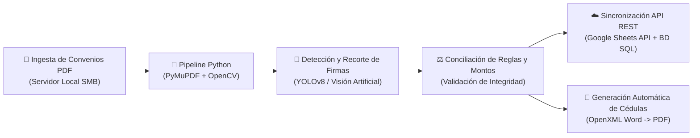

# Jesús Alejandro Buendía Hernández
**Ingeniero en Sistemas Computacionales (ESCOM-IPN) | Automatización con IA, Backend (`.NET 8` / `Python`) & Ciberseguridad (`eJPTv2`)**

📍 Ciudad de México | ✉️ [jbuendiah01@gmail.com](mailto:jbuendiah01@gmail.com) | 🛡️ Certificación: **eJPTv2 (Junior Penetration Tester — INE Security)**

---

## 👨‍💻 Resumen Profesional
Ingeniero de Software y Especialista en Automatización y Seguridad Aplicativa con experiencia llevando sistemas, APIs y flujos automatizados a **producción en entornos de misión crítica (C5 CDMX y SNDIF)**. Me especializo en sustituir procesos manuales complejos por pipelines automatizados, integrando **APIs REST, Webhooks, Visión Artificial (OpenCV / YOLO), LLMs, bases de datos SQL** y controles de seguridad bajo **OWASP Top 10 e ISO 27001**.

> 🔒 **Nota sobre código institucional:** Por normativa gubernamental y confidencialidad de datos sensibles en el **C5 CDMX** (79,000+ activos de seguridad ciudadana alojados en Bitbucket privado on-premise) y en el **SNDIF** (convenios financieros federales), el código fuente institucional es privado. A continuación documento la arquitectura técnica de las automatizaciones que he diseñado y operado en producción, junto con mis repositorios públicos.

---

## ⚙️ Automatizaciones e Integraciones Llevadas a Producción

### 1. Pipeline de Auditoría Documental, Validación con IA y Sincronización Cloud (SNDIF)
Sistema en producción que automatiza la revisión técnica, validación visual de firmas y conciliación de bases de datos para **+350 expedientes técnicos y convenios financieros federales (+$2,700 MDP)** de las 32 entidades federativas.

* **Impacto real:** Eliminación de captura manual, preservación de evidencia visual inalterable de firmas de autoridad, sincronización de **+850 registros** en tiempo real y tablero ejecutivo en **.NET 8 (C#, Chart.js y Google Maps API)** con seguridad **RBAC y Rate Limiting**.

---

### 2. Automatización de Flujos Operativos, Limpieza de BD y API Gateway (C5 CDMX)
Automatización de rutinas críticas y desarrollo de servicios backend para la operación continua 24/7 del Centro de Comando de la Ciudad de México (**+79,000 activos tecnológicos y +270 operadores por turno**).

* **Bots y Scripts de Automatización (`Python` + `Selenium WebDriver` + `T-SQL`):** Ejecución programada de flujos web, validación funcional, extracción de métricas y depuración de bases de datos en **SQL Server**, logrando una **reducción comprobada de 4 horas diarias de trabajo manual**.
* **Arquitectura Backend y Seguridad (`ASP.NET Core` + `SQL Server` + `IIS`):** Diseño de capa **API Gateway / BFF** con autenticación dual (`Cookie Auth + JWT`), procedimientos almacenados nativos y caché en cliente (`IndexedDB`) para acelerar la carga de mapas geoespaciales masivos.

---

## 🚀 Proyecto Público Destacado en este GitHub

### 💵 [TT2 — Sistema de Detección de Billetes Falsos con IA, Visión por Computadora y MLOps en Azure](https://github.com/Chuc4x/TT2)
Arquitectura completa de **Visión por Computadora y Deep Learning** desplegada en **Microsoft Azure App Service** que autentica billetes de $500 MXN mediante análisis de 11 candados de seguridad física:
* **Preprocesamiento adaptativo con `OpenCV`:** Segmentación automática de contornos en espacio `HSV`, evaluación matemática de calidad (desviación estándar de histograma y varianza del Laplaciano) y restauración automática mediante **CLAHE** (contraste en espacio `LAB`) y filtros de convolución (nitidez).
* **Inferencia con `Ultralytics YOLOv8 / YOLOv11` y `PyTorch`:** Detección simultánea de 11 elementos de seguridad (`hilo dinámico`, `marca de agua`, `folios/series`, `microtextos`, `efigie`, `carruaje`, etc.) expuesta vía **API REST (`Django REST Framework` + `Gunicorn`)**.
* **Pipeline de Reentrenamiento Continuo (`Active Learning`):** Script automatizado conectado a **Azure File Share** que descarga nuevos lotes de imágenes, valida la detección de candados y autogenera etiquetas normalizadas en formato YOLO para reentrenar el modelo.

---

## 🛠️ Stack Tecnológico

* **Lenguajes & Backend:** `Python`, `C#`, `.NET 8 / ASP.NET Core`, `JavaScript (ES6+)`, `SQL (T-SQL / PostgreSQL / MySQL)`, `Bash`, `PowerShell`
* **Automatización, APIs & IA:** `APIs REST`, `Webhooks`, `n8n`, `Claude Code / Codex`, `OpenCV`, `YOLOv8 / YOLOv11`, `PyTorch`, `Selenium`, `PyMuPDF`, `OpenXML`
* **Infraestructura, Cloud & DevOps:** `Microsoft Azure (App Service, File Share, Functions)`, `Linux VPS`, `Windows Server / IIS`, `Docker`, `Git / GitHub / Bitbucket`, `CI/CD (GitHub Actions)`
* **Ciberseguridad & Gobernanza:** Certificación **`eJPTv2`**, `OWASP Top 10`, `Active Directory / IAM / RBAC / JWT`, `Nmap`, `Metasploit`, `Burp Suite`, `ISO 27001`, `ITIL`
