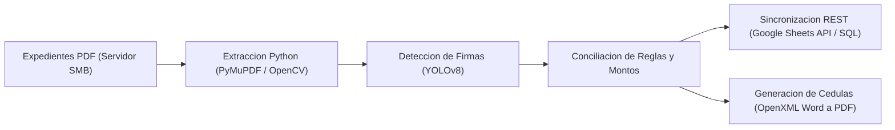
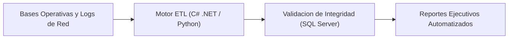

# Jesús Alejandro Buendía Hernández

**Ingeniero en Sistemas Computacionales (IPN - ESCOM)**  
Desarrollo Backend (`.NET` / `Python`), Automatización de Procesos, Integración de APIs y Ciberseguridad (`eJPTv2`)  
Ciudad de México, México | [jbuendiah01@gmail.com](mailto:jbuendiah01@gmail.com)

---

## Sobre mí

Ingeniero de software enfocado en llevar automatizaciones de procesos operativos, integraciones vía API REST/webhooks y herramientas de auditoría técnica a producción. Combino desarrollo backend en **Python** y **C# (.NET)** con bases de datos relacionales (**SQL Server / PostgreSQL**), procesamiento documental automatizado, modelos de **Visión por Computadora (YOLO / OpenCV)** y prácticas de seguridad ofensiva/defensiva (**eJPTv2**).

> **Nota sobre repositorios privados:** Los sistemas y flujos de automatización desarrollados para dependencias públicas (**SNDIF** y **C5 CDMX**) operan sobre infraestructura gubernamental e información sensible bajo convenio de confidencialidad, por lo que su código fuente no es público. A continuación describo la arquitectura técnica implementada en cada uno.

---

## Automatizaciones e Integraciones en Producción

### 1. Pipeline de Auditoría Documental, Validación con IA y Sincronización Cloud (SNDIF)

Sistema interno en producción que automatiza la revisión técnica, validación visual de firmas de autoridad y conciliación de datos para más de **350 expedientes técnicos y convenios financieros federales (+$2,700 MDP)** de las 32 entidades federativas.

- **Problema resuelto:** Revisión manual de cientos de convenios en PDF e inconsistencias al capturar montos, firmas y anexos técnicos en hojas de cálculo compartidas.
- **Implementación:**
  - Extracción automatizada de texto, tablas e imágenes desde documentos PDF almacenados en servidor de archivos local.
  - Detección y recorte automático de bloques de firma mediante modelos de visión artificial para respaldar la evidencia documental.
  - Sincronización bidireccional mediante **Google Sheets API** y consultas **SQL**, generando automáticamente las cédulas de validación oficial en Word y PDF.

---

### 2. Sistema de Consolidación, Cruce y Reporteo de Infraestructura Crítica (C5 CDMX)

Automatización para el seguimiento operativo de **+15,000 sitios y +80,000 activos tecnológicos** de videovigilancia y telecomunicaciones en la Ciudad de México.

- **Problema resuelto:** Cruces manuales entre múltiples bases de datos de enlaces de red, fallas eléctricas e inventario físico que tomaban horas de procesamiento diario.
- **Implementación:**
  - Desarrollo de rutinas en **C# (.NET)** y **Python** conectadas a **SQL Server** para normalizar registros, detectar discrepancias de disponibilidad y generar reportes estandarizados para toma de decisiones operativas.

---

## Proyectos Públicos en este Perfil

### [TT2 — Detección de Billetes Falsos con Deep Learning y API REST](https://github.com/Chuc4x/TT2)
Backend en **Django REST Framework**, **PyTorch (Ultralytics YOLOv8/v11)** y **OpenCV**, desplegado en **Microsoft Azure**, para verificar la autenticidad de billetes de $500 MXN mediante análisis de 11 elementos de seguridad e integración de un pipeline de reentrenamiento continuo conectado a Azure File Share.

---

## Stack Técnico

- **Lenguajes:** Python, C# (.NET), SQL (T-SQL / PostgreSQL), JavaScript, Bash / PowerShell.
- **Automatización, APIs y Datos:** REST APIs, Webhooks, n8n, Django REST Framework, ASP.NET Core, Pandas, PyMuPDF, OpenXML, Google APIs.
- **Inteligencia Artificial y Visión:** PyTorch, Ultralytics YOLOv8 / YOLOv11, OpenCV, preprocesamiento de imagen (CLAHE, segmentación HSV, filtros morfológicos).
- **Infraestructura y Seguridad:** Linux (VPS / Ubuntu / Kali), Microsoft Azure (App Service, Storage), Git / GitHub, Docker básico, Pentesting y análisis de vulnerabilidades (**eJPTv2**, OWASP Top 10, Burp Suite, Nmap).
